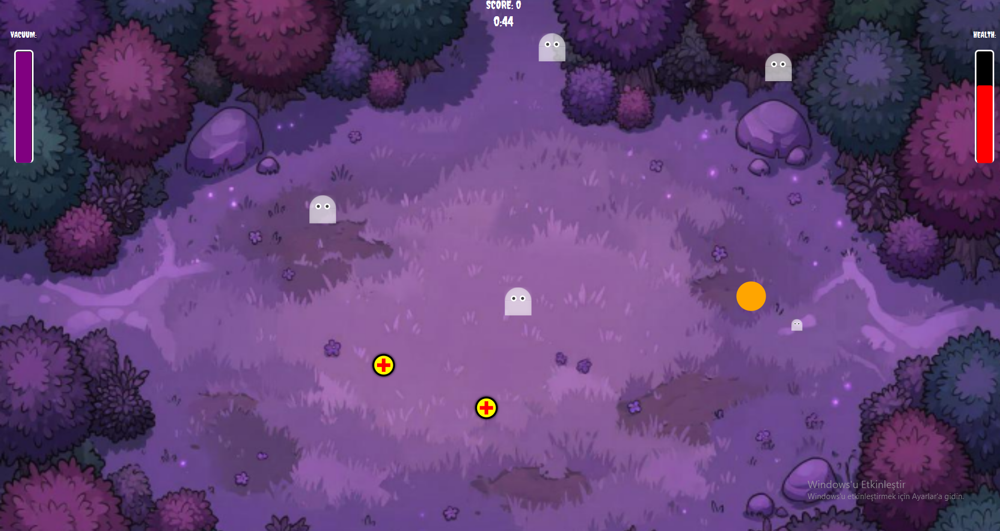

# Ghost Hunter Project

A 2D game developed with Java and JavaFX by a three-member team as a first-year university project.

## Gameplay

The player uses a vacuum to shrink and eliminate ghosts within its effective range while avoiding damage from ghosts. Movement and vacuum direction must be coordinated to survive.
## Screenshot



## Controls

| Input | Action |
|---|---|
| W, A, S, D or arrow keys | Move the player |
| Space | Activate the vacuum |
| Mouse | Aim the vacuum |

## Technologies

- Java
- JavaFX
- Git
- Eclipse IDE

## My Contributions

My contributions included:

- Config Reader
- Game Config
- Game Controller
- Entity views

## Team Project

This repository is a portfolio copy of a project developed collaboratively by three students. The contributions listed above describe my own work; the full game includes work by all team members.

## Running the Game in Eclipse

The game has been tested locally on Windows using Eclipse, JDK 25 and JavaFX SDK 26.0.1.

1. Clone or download this repository. Use the `portfolio-version` branch.
2. Install JDK 25 and download JavaFX SDK 26.0.1 for your operating system.
3. In Eclipse, select **File → Import → General → Existing Projects into Workspace** and import the project folder.
4. Configure the project's JRE to use JDK 25.
5. Add the JavaFX JAR files from the SDK's `lib` folder to the project's Java Build Path. Replace any library references that point to another computer.
6. Open **Run → Run Configurations → Java Application** and create a configuration with:
   - **Project:** `ghost-hunter-project`
   - **Main class:** `com.ghosthunter.Test`
7. In **Arguments → VM arguments**, enter:

   ```text
   --module-path "PATH_TO_JAVAFX_SDK/lib" --add-modules javafx.controls,javafx.fxml --enable-native-access=javafx.graphics
   ```

   Replace `PATH_TO_JAVAFX_SDK` with the actual JavaFX SDK folder on your computer.

8. Set the working directory to the project root, which contains `config.txt`.
9. Click **Run**.

These instructions describe the author's working setup. Other Java and JavaFX versions have not been verified.
